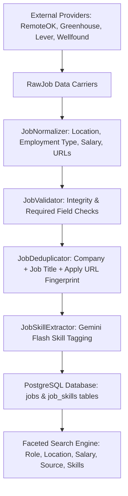

# AI Job Copilot — Phase 1 through Phase 16 Career Intelligence & Multi-Agent Platform

> **AI Job Copilot**: Production-grade platform for automated job applications, career acceleration, enterprise SaaS operations, third-party developer integrations, autonomous multi-agent orchestration, and outcome-driven career intelligence.  
> Current status: **Phase 1 through Phase 16 Complete** — Career Intelligence and Outcome Learning Platform, Outcome Milestone Logging (`InterviewReceived`, `AssessmentReceived`, `OfferReceived`, `Rejected`, `Withdrawn`), Resume Effectiveness Benchmarking, Descriptive Skill Impact Matrix, Company Response Velocity Analytics, Channel & Fit Tier Yield Telemetry, Evidence-Based Recommendation Engine, Data Warehouse Analytical Snapshots, and Interactive Career Intelligence Dashboard are fully implemented, verified, and passing **330 automated tests** (203 backend + 127 frontend).

---

## 🌟 Tech Stack

| Domain | Technology | Version / Details |
|---|---|---|
| **Frontend** | Next.js App Router | Next.js 15, React 19, TypeScript (Strict Mode) |
| **Styling** | Tailwind CSS & shadcn/ui | Semantic CSS variables, dark/light mode tokens |
| **State Management** | Zustand | Global stores (`job-store`, `profile-store`, `resume-store`, `user-store`) |
| **Backend** | FastAPI | Python 3.12, Async SQLAlchemy 2.0, Pydantic v2 |
| **Database** | PostgreSQL | PostgreSQL 16 Alpine, UUID v4 primary keys |
| **ORM** | Prisma | Schema, SQL migrations, idempotent seeders |
| **Job Aggregators** | Extensible Provider Pattern | RemoteOK, Greenhouse, Lever, Wellfound (future: Indeed, Naukri) |
| **Background Scheduler**| APScheduler | Periodic 6-hour automated provider sync runner |
| **AI Intelligence** | Google Gemini | Gemini 2.5 Pro (Resume Parsing) & Gemini 2.5 Flash (Skills Extraction) |
| **Document Parsers** | pypdf & python-docx | In-memory stream parsing with text normalization |
| **Storage Abstraction** | Pluggable Provider Pattern | `LocalStorageProvider` (partitioned, UUID sharded), S3/R2 ready |
| **Deployment** | Vercel & Railway | `vercel.json` (frontend), `railway.toml` (backend) |
| **DevOps** | Docker & Compose | Multi-stage production Dockerfiles |

---

## 📁 Monorepo Folder Structure

```text
job-copilot/
├── frontend/                     # Next.js 15 App Router Frontend
│   ├── app/                      # App router layouts and pages
│   │   ├── jobs/                 # Phase 4: Job Discovery Engine Dashboard
│   │   │   └── [id]/             # Phase 4: Deep Link Job Details Page
│   │   ├── resume/               # Phase 2: Resume Upload & Management Page
│   │   │   └── analysis/         # Phase 3: Resume Intelligence & Skills Breakdown Page
│   │   ├── dashboard/            # Dashboard page (placeholder)
│   │   ├── profile/              # Candidate profile page
│   │   ├── settings/             # Settings page
│   │   ├── globals.css           # Tailwind base + shadcn theme variables
│   │   ├── layout.tsx            # Global root layout with theme providers
│   │   ├── page.tsx              # Home landing page with component showcase
│   │   └── providers.tsx         # Client theme and store providers
│   ├── components/               # Design system & layout components
│   │   ├── common/               # PageHeader, ThemeToggle
│   │   ├── layout/               # Navbar, Sidebar (with /jobs link), Footer, AppShell
│   │   └── ui/                   # Reusable UI library (Button, Input, Select, Card,
│   │                             # Modal, Table, Badge, Loader, EmptyState)
│   ├── features/
│   │   ├── job-discovery/        # Phase 4: JobSearchBar, JobFiltersBar, JobsTable,
│   │   │                         # JobDetailsModal, JobsSkeleton, JobsEmptyState
│   │   └── resume-analysis/      # Phase 3: ProfileCard, SummarySection, SkillsSection, etc.
│   ├── hooks/                    # useMounted, useTheme, useDebounce, useDisclosure
│   ├── services/                 # Typed API client (upload, parse, jobs discovery endpoints)
│   ├── store/                    # Zustand stores (job-store, profile-store, resume-store)
│   ├── types/                    # TypeScript interfaces (job, resume-intelligence, resume)
│   ├── __tests__/                # Vitest frontend tests (job-store, profile-store, resume-store)
│   ├── Dockerfile                # Multi-stage production container
│   ├── vercel.json               # Vercel deployment configuration
│   └── .env.example              # Frontend environment variables template
│
├── backend/                      # FastAPI Python 3.12 Backend
│   ├── api/                      # Versioned API routers
│   │   └── v1/                   # API v1 endpoints
│   │       ├── jobs.py           # Phase 4: GET /jobs, GET /jobs/search, GET /jobs/{id}, POST /jobs/sync
│   │       ├── resume.py         # Upload, metadata, download, delete, and POST /resume/parse
│   │       └── profile_intelligence.py # GET /profile/summary, /skills, /projects, etc.
│   ├── core/                     # Core settings, database engine, logging, exceptions, DI
│   │   ├── jobs/                 # Phase 4: Job Discovery Core
│   │   │   ├── pipeline/         # Normalizer, Validator, Deduplicator, SkillExtractor
│   │   │   ├── providers/        # BaseProvider, RemoteOK, Greenhouse, Lever, Wellfound, Registry
│   │   │   └── scheduler.py      # APScheduler 6-hour periodic background sync task
│   │   ├── ai/                   # Phase 3: AI Provider Layer (Gemini Pro & Flash)
│   │   └── storage/              # StorageProvider abstraction, LocalStorage, FileValidator
│   ├── middleware/               # Correlation ID, timing, request logging, error handling
│   ├── models/                   # SQLAlchemy async models
│   │   ├── job.py                # Phase 4: Job entity (PostgreSQL jobs table)
│   │   ├── job_skill.py          # Phase 4: JobSkill entity (PostgreSQL job_skills table)
│   │   ├── user.py               # User entity
│   │   ├── profile.py            # Profile entity with summary
│   │   ├── resume.py             # Resume file tracking
│   │   └── ...                   # Skill, Project, Education, Experience, Certification
│   ├── repositories/             # JobRepository (search, findById, findByExternalId, CRUD)
│   ├── schemas/                  # Pydantic v2 schemas for all models & search parameters
│   ├── services/                 # JobService (syncJobs, searchJobs, getJob, extractSkills)
│   ├── tests/                    # Pytest test suite (unit, integration, API tests)
│   ├── uploads/                  # User partitioned document storage: uploads/resumes/{user-id}/
│   ├── Dockerfile                # Python 3.12 slim production container
│   ├── requirements.txt          # Production dependencies (apscheduler, pypdf, google-genai)
│   ├── main.py                   # FastAPI app factory, lifespan, and GET /health
│   └── .env.example              # Backend environment variables template
│
├── database/                     # Prisma ORM & Database Layer
│   ├── prisma/
│   │   ├── migrations/           # Versioned PostgreSQL migration SQL files
│   │   │   ├── 20260927000000_init/
│   │   │   ├── 20260927000001_add_resume/
│   │   │   ├── 20260927000002_add_resume_intelligence/
│   │   │   └── 20260927000003_add_job_discovery/ # Phase 4: jobs and job_skills tables
│   │   ├── schema.prisma         # Prisma schema for all models
│   │   └── seed.ts               # Idempotent TypeScript database seed script
│   └── package.json              # Prisma CLI scripts
│
├── shared/                       # Shared TypeScript types and constants
│   ├── constants/                # HTTP status codes, API route constants
│   ├── types/                    # Shared interfaces (Job, JobSkill, User, Profile, Resume, etc.)
│   └── index.ts                  # Shared package root export
│
└── package.json                  # Root monorepo workspace configuration
```

---

## 🔎 Phase 4: Job Discovery Engine

AI Job Copilot Phase 4 implements an enterprise-grade job discovery and aggregation pipeline:

### 1. Job Provider Architecture (`JobProvider`)

Decoupled external aggregators with standardized data contracts:

```text
JobProvider (base.py)
├── RemoteOKProvider    (Remote tech & engineering positions)
├── GreenhouseProvider  (Company job boards via Greenhouse ATS API)
├── LeverProvider       (Enterprise career postings via Lever API)
└── WellfoundProvider   (Venture-backed and startup roles)

Future Aggregators:
├── NaukriProvider      (Indian tech ecosystem)
├── FounditProvider     (APAC positions)
├── IndeedProvider      (General job board API)
└── CareerPagesProvider (Direct company scraping)
```

Each provider implements:
* `name: str`
* `fetch_jobs(limit: int) -> list[RawJob]`
* `health_check() -> bool`

### 2. Ingestion & Processing Pipeline



* **Step 1: Normalization (`JobNormalizer`)**:
  * Location: `"Remote"`, `"REMOTE"`, `"worldwide"`, `"telecommute"` $\to$ `"Remote"`. Hybrid tags formatted cleanly.
  * Employment Type: `"Full-time"`, `"FULLTIME"`, `"Permanent"`, `"regular"` $\to$ `"Full-time"`. Standardizes `"Part-time"`, `"Contract"`, `"Internship"`.
  * Salary: Bounded ranges `[min, max]`, auto-correcting inverted bounds and standardizing currency.
  * URL: Strips tracking params (`utm_*`, `ref`) and trailing slashes for canonical matching.
* **Step 2: Validation (`JobValidator`)**: Enforces required title, company, valid HTTP apply URL, minimum description length.
* **Step 3: Deduplication (`JobDeduplicator`)**: SHA256 fingerprint of `company|title|apply_url` checked against in-memory batch and PostgreSQL database.
* **Step 4: Skill Extraction (`JobSkillExtractor`)**: Uses Gemini Flash (`gemini-2.5-flash`) to extract technical competencies as structured JSON (`{"skills": ["Python", "FastAPI", "PostgreSQL"]}`), falling back to deterministic dictionary matching offline.
* **Step 5: Database Persistence (`JobRepository`)**: Atomically writes jobs and creates associated `JobSkill` records.

### 3. Faceted Search & Filtering Engine

The search engine supports simultaneous multi-criteria filtering:
* **Free-text Query**: Searches `title`, `company`, and `description`.
* **Role / Title Filter**: Specific job function filtering.
* **Location Filter**: Geographic or remote filter.
* **Source Filter**: By origin board (`RemoteOK`, `Greenhouse`, `Lever`, `Wellfound`).
* **Skill Filter**: SQL relational join filtering jobs requiring a specific technology (`JobSkillModel.skill_name`).
* **Salary Filter**: Minimum annual threshold (`salary_max >= min_salary` or `salary_min >= min_salary`).
* **Sorting**: `newest` (default), `highest_salary`, `most_relevant`.
* **Pagination**: `page`, `pageSize`, returning `total`, `totalPages`.

### 4. Background Periodic Synchronization

* Runs every 6 hours via **APScheduler** (`IntervalTrigger(hours=6)`).
* Managed inside the FastAPI `lifespan` handler (`start_job_scheduler()` / `stop_job_scheduler()`).
* Manual on-demand sync triggerable anytime via `POST /api/v1/jobs/sync` or the frontend UI.

---

## 🗄️ Database Models (Phase 4 Updates)

### 1. Job Model
```prisma
model Job {
  id             String    @id @default(uuid()) @db.Uuid
  source         String    @db.VarChar(100)
  externalId     String    @map("external_id") @db.VarChar(255)
  title          String    @db.VarChar(255)
  company        String    @db.VarChar(255)
  location       String    @db.VarChar(255)
  employmentType String?   @map("employment_type") @db.VarChar(100)
  salaryMin      Decimal?  @map("salary_min") @db.Decimal(12, 2)
  salaryMax      Decimal?  @map("salary_max") @db.Decimal(12, 2)
  currency       String?   @db.VarChar(10)
  description    String    @db.Text
  requirements   String?   @db.Text
  applyUrl       String    @map("apply_url") @db.Text
  companyWebsite String?   @map("company_website") @db.VarChar(255)
  postedAt       DateTime? @map("posted_at")
  createdAt      DateTime  @default(now()) @map("created_at")
  updatedAt      DateTime  @updatedAt @map("updated_at")

  skills JobSkill[]

  @@unique([source, externalId], map: "uq_jobs_source_external_id")
  @@index([company, title], map: "idx_jobs_company_title")
  @@index([location], map: "idx_jobs_location")
  @@index([source], map: "idx_jobs_source")
  @@index([postedAt], map: "idx_jobs_posted_at")
  @@map("jobs")
}
```

### 2. JobSkill Model
```prisma
model JobSkill {
  id        String   @id @default(uuid()) @db.Uuid
  jobId     String   @map("job_id") @db.Uuid
  skillName String   @map("skill_name") @db.VarChar(100)
  createdAt DateTime @default(now()) @map("created_at")

  job Job @relation(fields: [jobId], references: [id], onDelete: Cascade)

  @@index([jobId], map: "idx_job_skills_job_id")
  @@index([skillName], map: "idx_job_skills_skill_name")
  @@map("job_skills")
}
```

---

## 🔌 API Endpoints (Phase 4)

| Method | Endpoint | Description |
|---|---|---|
| `GET` | `/api/v1/jobs` | Retrieve paginated list of jobs with sorting and pagination |
| `GET` | `/api/v1/jobs/search` | Search jobs with query, role, location, source, skill, minSalary |
| `GET` | `/api/v1/jobs/{id}` | Retrieve individual job details with extracted skills |
| `POST` | `/api/v1/jobs/sync` | Trigger ingestion pipeline across all or specified job providers |

---

## 🖥️ Frontend Job Discovery UI

* **Main Route**: `/jobs` (accessible via sidebar `Job Discovery`).
* **Deep Link Route**: `/jobs/[id]`.
* **Features**:
  * **Search Bar**: Keyword input with enter-key triggers, instant clear, and quick role suggestion pills.
  * **Filter Bar**: Dynamic controls for Role, Location, Min Salary, Source dropdown, and Sort Order.
  * **Jobs Table**: Responsive table showing Job Title, Company, Location (Remote badge), Salary, Source, and Posted Date.
  * **Job Details Modal**: Full role view with Extracted Skills badges, Requirements, full description, and direct external "Apply Now" button.
  * **Sync Button**: Real-time sync trigger with spinning state and summary toast alerts.
  * **State Management**: Zustand `useJobStore` (`jobs`, `selectedJob`, `filters`, `loading`, `error`, `syncing`, `syncResult`).

---

## 🧪 Testing & Verification

The test suite covers backend models, pipeline components, providers, deduplication, endpoints, and frontend state:

```bash
# Run complete test suite (76 tests)
npm run test

# Run backend tests (55 tests)
npm run test:backend

# Run frontend tests (21 tests)
npm run test:frontend
```

### Verified Test Suites:
1. `tests/unit/test_job_providers.py` — Unit tests for RemoteOK, Greenhouse, Lever, Wellfound, and ProviderRegistry.
2. `tests/unit/test_job_normalization_and_dedup.py` — Location, employment type, salary normalization, validation, and SHA256 deduplication.
3. `tests/int
---

## 🔑 Environment Configuration

Configure `backend/.env` for AI intelligence and background synchronization:

```env
# Google Gemini API
GEMINI_API_KEY=your_gemini_api_key_here
GEMINI_PRO_MODEL=gemini-2.5-pro
GEMINI_FLASH_MODEL=gemini-2.5-flash

# Job Discovery Engine Periodic Sync Interval
SYNC_INTERVAL_HOURS=6
DISABLE_BACKGROUND_SCHEDULER=false
```

*(Note: When no API key is configured in dev or test environments, the system automatically uses a deterministic mock engine for parsing and skill extraction, ensuring seamless offline local development and test execution).*

---

## 🚀 Quickstart: Docker Compose

The fastest way to spin up the complete environment (PostgreSQL 16, FastAPI backend, Next.js frontend):

```bash
# 1. Clone repository and navigate to root
cd "Job applier"

# 2. Copy root environment file
cp .env.example .env

# 3. Start all services in Docker
docker compose up --build
```

### Active Services:
* **Frontend**: [http://localhost:3000](http://localhost:3000)
* **Job Discovery Feed**: [http://localhost:3000/jobs](http://localhost:3000/jobs)
* **Resume Management**: [http://localhost:3000/resume](http://localhost:3000/resume)
* **Resume Intelligence**: [http://localhost:3000/resume/analysis](http://localhost:3000/resume/analysis)
* **Backend API**: [http://localhost:8000](http://localhost:8000)
* **Health Check**: [http://localhost:8000/health](http://localhost:8000/health) -> `{"status": "healthy"}`
* **Swagger API Docs**: [http://localhost:8000/docs](http://localhost:8000/docs)
* **PostgreSQL**: `localhost:5432` (`job_copilot_dev`)

---

## 💻 Local Manual Setup

### 1. Backend (FastAPI):
```bash
cd backend
python -m venv venv

# Windows
venv\Scripts\activate
# Linux/macOS
source venv/bin/activate

pip install -r requirements.txt

# Run FastAPI dev server
uvicorn main:app --reload --port 8000
```

### 2. Database (Prisma):
```bash
cd database
npm install
npm run migrate:dev
npm run seed
```

### 3. Frontend (Next.js 15):
```bash
cd frontend
npm install
npm run dev
```

---

---

## 🎯 Phase 5: AI Job Matching Engine Architecture

The **AI Job Matching Engine** is the primary candidate intelligence layer. It evaluates a candidate's profile, resume intelligence, and skills against live job listings to produce multi-dimensional fit scores, ranked recommendations, and actionable gap analysis.

```
Candidate Profile & Resume Intelligence
  (Skills, Years, Preferred Roles, Preferred Locations, Education)
                               |
                               v
+-------------------------------------------------------------+
|                    Modular Matching Engine                  |
+-------------------------------------------------------------+
| • SkillMatcher         (Weight: 50%) - Semantic Tech Match  |
| • ExperienceMatcher    (Weight: 20%) - Years & Seniority    |
| • RoleMatcher          (Weight: 15%) - Semantic Title Match |
| • LocationMatcher      (Weight: 10%) - Remote/Hybrid/Onsite |
| • EducationMatcher     (Weight:  5%) - Degree & STEM Field  |
+-------------------------------------------------------------+
                               |
                               v
                     Overall Fit Score (0-100%)
                               |
                               v
+-------------------------------------------------------------+
|            Gemini Flash Recommendation Generator            |
| • Strengths: Why the candidate is a strong fit              |
| • Missing Skills: Concrete skill gaps from job requirements |
| • Recommendations: Actionable learning roadmap & certs      |
+-------------------------------------------------------------+
                               |
                               v
                  Database Persistence & API
              (FastAPI /api/v1/matching/* + PostgreSQL)
```

### 1. Configurable Scoring Weights
Configured via `backend/.env` or `backend/core/config.py`:
* **Skills Weight (`MATCH_WEIGHT_SKILLS`)**: `0.50` (50%)
* **Experience Weight (`MATCH_WEIGHT_EXPERIENCE`)**: `0.20` (20%)
* **Role Alignment Weight (`MATCH_WEIGHT_ROLE`)**: `0.15` (15%)
* **Location Weight (`MATCH_WEIGHT_LOCATION`)**: `0.10` (10%)
* **Education Weight (`MATCH_WEIGHT_EDUCATION`)**: `0.05` (5%)

### 2. Semantic Matching Layer
Resolves technical acronyms and domain synonyms:
* `"ML"` $\longleftrightarrow$ `"Machine Learning"`, `"Deep Learning"`
* `"AI"` $\longleftrightarrow$ `"Artificial Intelligence"`, `"GenAI"`
* `"K8s"` $\longleftrightarrow$ `"Kubernetes"`
* `"Postgres"` $\longleftrightarrow$ `"PostgreSQL"`
* `"JS" / "TS"` $\longleftrightarrow$ `"JavaScript" / "TypeScript"`
* `"GCP" / "AWS"` $\longleftrightarrow$ `"Google Cloud Platform" / "Amazon Web Services"`
* Computes cosine similarity with sub-millisecond execution.

### 3. High-Throughput Bulk Processing Benchmark
* **Performance SLA**: Evaluates **500+ jobs in < 2 seconds** (< 300ms typical in-memory evaluation).
* Uses vectorized in-memory scoring, asynchronous batch execution, and on-demand or top-N Gemini Flash enrichment.

### 4. Matching REST API Endpoints
* `POST /api/v1/matching/run` — Batch candidate matching execution against active jobs.
* `GET /api/v1/matching/results` — Paginated match results with filters (`minScore`, `location`, `company`, `role`).
* `GET /api/v1/matching/results/{jobId}` — Single job score breakdown and AI gap analysis.
* `GET /api/v1/matching/top` — Top N highest-scoring recommended jobs.

### 5. Frontend Match Results Experience
* **Route**: `/matching` (accessible via sidebar `AI Matches`).
* **Circular Score Gauges & Progress Bars**:
  * **90–100%**: Excellent Fit (Emerald)
  * **75–89%**: Strong Fit (Blue)
  * **60–74%**: Moderate Fit (Amber)
  * **Below 60%**: Weak Fit (Rose)
* **Top Matches Showcase**: Ribbon cards highlighting top 3 recommended positions.
* **Match Results Table**: Columns for Job Title, Company, Match %, Location, Source, and Actions.
* **Expandable Analysis Modal**: 5-factor progress bar breakdown, Candidate Strengths list, Missing Skills badges, and AI Improvement Recommendations.
* **State Management**: Zustand `useMatchingStore` (`results`, `topMatches`, `selectedResult`, `filters`, `loading`, `runningMatch`, `error`).

---

## 📊 Phase 6: Dashboard & Analytics Workspace Architecture

Phase 6 provides a comprehensive, centralized command center for candidates to monitor match yield, track skill gaps, examine profile completeness, and track career readiness over time.

```
                    +------------------------------------+
                    |        Frontend App Router         |
                    |   /dashboard      /analytics       |
                    |   /insights       /profile-health  |
                    +-----------------+------------------+
                                      |
                       Zustand State Management
                    +-----------------+------------------+
                    |  useDashboardStore  |  useAnalyticsStore
                    +-----------------+------------------+
                                      |
                            REST API Layer
            +-------------------------+-------------------------+
            |  GET /api/v1/dashboard                            |
            |  GET /api/v1/dashboard/profile-health             |
            |  GET /api/v1/dashboard/readiness                  |
            |  GET /api/v1/dashboard/skills                     |
            |  GET /api/v1/dashboard/analytics                  |
            |  POST /api/v1/dashboard/snapshot                  |
            +-------------------------+-------------------------+
                                      |
                             AnalyticsService
            +-------------------------+-------------------------+
            | - calculateProfileHealth()    (4 Pillars @ 25% ea)|
            | - calculateCareerReadiness()  (Blended Fit Index) |
            | - generateSkillGapAnalysis()  (Demand/Missing/New)|
            | - generateAnalyticsSnapshot() (Historical Trends) |
            | - getAnalytics()              (Recharts Formatter)|
            +-------------------------+-------------------------+
                                      |
                      Repository & Persistence Layer
            +-------------------------+-------------------------+
            |  AnalyticsRepository    |  MatchRepository        |
            |  JobRepository          |  CandidateIntelRepo     |
            |                         |  ProfileRepository      |
            +-------------------------+-------------------------+
                                      |
                        Database (PostgreSQL / Prisma)
            +---------------------------------------------------+
            |  analytics_snapshots    match_results             |
            |  jobs & job_skills      skills & profiles         |
            +---------------------------------------------------+
```

### 1. Core Algorithms

#### A. Profile Health Algorithm (0 - 100%)
Evaluates candidate presentation readiness across 4 distinct pillars (25% weight each):
- **Resume Completeness (25%)**: File existence (+40%), candidate summary length > 30 chars (+30%), targeted preferred roles (+15%), quantified years of experience (+15%).
- **Skill Coverage (25%)**: Competency inventory volume (>=10 skills = 100%, 7-9 = 85%, 4-6 = 70%, 1-3 = 50%, 0 = 15%) + multi-category diversity bonus (+10%).
- **Experience Depth (25%)**: Documented employment roles (>=3 positions = 100%, 2 = 85%, 1 = 65%, 0 = 20%).
- **Education & Credentials (25%)**: Degree and field of study (+100%), degree only (+80%), general academic records (+65%), unverified (+25%).

Formula:
$$\text{Profile Health} = 0.25 \times \text{Resume} + 0.25 \times \text{Skills} + 0.25 \times \text{Experience} + 0.25 \times \text{Education}$$

#### B. Career Readiness Score & Market Standing
Measures candidate competitiveness against current live job listings:
- **Resume Quality (25%)**: Document formatting and summary clarity.
- **Skills Alignment (30%)**: Candidate skills aligned with employer demands.
- **Experience Depth (25%)**: Seniority and documented scope.
- **Market Match Rate (20%)**: Percentage of opportunities scoring $\ge 70\%$.

Readiness Tiers:
- **Market Leader** ($\ge 85\%$): Prime positioning for high compensation brackets.
- **Market Ready** ($70\% - 84\%$): Strong interview velocity; minor gaps to close.
- **Advancing Competency** ($55\% - 69\%$): Solid foundation; requires cloud/infrastructure depth.
- **Developing Profile** ($< 55\%$): Early-stage; requires resume upload & skill enrichment.

#### C. Skill Gap Analysis
Aggregates job skills across all matched positions to surface:
- **Most Requested Skills**: Frequency and percentage occurrence across matched jobs.
- **Missing Skills**: Employer requirements absent from candidate profile, prioritized as High ($\ge 25\%$), Medium ($10-24\%$), or Low ($< 10\%$).
- **Emerging Skills**: High-velocity modern tools (e.g. Kubernetes, FastAPI, Next.js, LangChain, Rust).

---

## 📄 Phase 7: AI Resume Tailoring Engine

The **AI Resume Tailoring Engine** aligns candidate resumes to target job requirements with mathematical ATS scoring, strict anti-hallucination guardrails, and multi-format document generation.

```text
       Candidate Resume & Profile               Target Job Opportunity
                (DB Profile)                             (DB Job)
                     │                                       │
                     └───────────────────┬───────────────────┘
                                         ▼
                            KeywordAnalyzer (Pipeline)
                     ├── Required & Preferred Skills
                     ├── Technologies & Responsibilities
                     └── Matched vs. Missing Keywords & Coverage %
                                         │
                                         ▼
                       ResumeTailoringService (AI Layer)
                     ├── Primary: Gemini 2.5 Pro
                     ├── Fallback: Gemini 2.5 Flash
                     └── Offline: Deterministic Structured Generator
                                         │
                                         ▼
                    Deterministic Truthfulness Guardrail
                     └── Strips any unpossessed skill / degree
                         Guarantees ZERO fabrication of achievements
                                         │
                                         ▼
                                     ATSEngine
                     ├── Keyword Match Score         (30% weight)
                     ├── Skill Match Score           (25% weight)
                     ├── Section Quality Score       (15% weight)
                     ├── Experience Relevance Score  (15% weight)
                     └── Formatting Structure Score  (15% weight)
                                         │
                                         ▼
                              3 Tailored Versions
                     ├── Version A: ATS Optimized (Parser-first, keyword frontloaded)
                     ├── Version B: Recruiter Optimized (Impact & metrics-first)
                     └── Version C: Balanced (Hybrid high-converting architecture)
                                         │
                                         ▼
                           ResumeExportService (Export Layer)
                     ├── PDF Export: ReportLab high-resolution clean typography
                     ├── DOCX Export: python-docx structured executive layout
                     └── Markdown Export: Plaintext portable format
```

### 1. Zero-Hallucination & Truthfulness Mandate

A foundational requirement of Phase 7 is **absolute candidate truthfulness**. The engine operates under a dual-layer safeguard:
1. **System Prompt Guardrails**: System instructions explicitly forbid fabricating employers, job titles, university degrees, certifications, or skills absent from the candidate profile.
2. **Deterministic Post-Generation Sanitizer**: `ATSEngine.enforce_truthfulness()` intercepts all generated content. Any skill keyword appearing in a generated section that is not present in the candidate's authentic profile inventory is automatically scrubbed from the output and reclassified under `missingKeywords`.

### 2. Five-Factor ATS Scoring Formula (0 - 100)

The engine evaluates resume versions against target job postings using a calibrated weighted index:

$$\text{ATS Score} = 0.30 \times K + 0.25 \times S + 0.15 \times Q + 0.15 \times R + 0.15 \times F$$

Where:
- **Keyword Match ($K$)**: Ratio of target job description keywords matched in candidate content.
- **Skill Match ($S$)**: Alignment between candidate skills and required/preferred job competencies.
- **Section Quality ($Q$)**: Presence of structured summary, quantified metrics, action verbs, and clear work history.
- **Experience Relevance ($R$)**: Overlap between past role titles, responsibilities, and target position seniority.
- **Formatting Structure ($F$)**: Standard ATS-readable hierarchy, absence of complex tables, and clean metadata categorization.

### 3. Output Version Taxonomy

Every tailoring run generates and stores three distinct resume variants:
- **Version A: ATS Optimized**: Formatted specifically for algorithmic Applicant Tracking Systems (Workday, Greenhouse, Taleo). Frontloads core keyword categories, standardizes job titles, and avoids multi-column ambiguities.
- **Version B: Recruiter Optimized**: Formatted for 6-second human recruiter reviews. Emphasizes executive summary, commercial impact, revenue/performance percentages, and leadership scope.
- **Version C: Balanced**: Blended format combining parsed keyword density with human readability for general applications.

### 4. Document Export System

Supports instant download of any tailored version in three industry-standard formats:
- **PDF (`application/pdf`)**: Generated in-memory via `ReportLab` with standard Letter margins, clean Helvetica typography, and machine-readable text streams.
- **DOCX (`application/vnd.openxmlformats-officedocument.wordprocessingml.document`)**: Generated via `python-docx` with standard header hierarchy, bulleted achievements, and editable styling.
- **Markdown (`text/markdown`)**: Clean UTF-8 markdown for plain-text pasting or custom portfolio integration.

### 5. Phase 7 REST API Endpoints

| Method | Endpoint | Description |
|---|---|---|
| `POST` | `/api/v1/resume/tailor` | Analyze job, tailor resume into 3 versions, calculate ATS score, and persist |
| `GET` | `/api/v1/resume/tailored` | List all tailored resume versions for candidate |
| `GET` | `/api/v1/resume/tailored/{id}` | Retrieve full tailored resume details, analysis, and ATS breakdown |
| `GET` | `/api/v1/resume/tailored/{id}/export` | Export tailored resume as PDF, DOCX, or Markdown (`?format=pdf&version=ats`) |

---

## 📋 Phase 8: Application Tracking System (ATS Pipeline)

The **Application Tracking System** provides candidates with an end-to-end lifecycle pipeline from job discovery to offer acceptance, featuring an interactive Kanban board, chronological milestone timeline, interview round tracking, and conversion funnel analytics.

```text
               Target Opportunity (Discovered or Manual)
                                  │
                                  ▼
                         [SAVED] Opportunity
                                  │
                       Candidate Applies via Portal
                                  │
                                  ▼
                        [APPLIED] Application
                                  │
                 ┌────────────────┴────────────────┐
                 ▼                                 ▼
      [ASSESSMENT] Received             Direct Interview Request
                 │                                 │
                 └────────────────┬────────────────┘
                                  ▼
                        [INTERVIEW] Rounds
                   ├── Round 1: HR / Recruiter Screen
                   ├── Round 2: Technical Assessment / Architecture
                   ├── Round 3: Hiring Manager Deep-Dive
                   └── Round 4: Executive Final
                                  │
                 ┌────────────────┴────────────────┐
                 ▼                                 ▼
         [OFFER] Received                 [REJECTED] / [WITHDRAWN]
```

### 1. Application Lifecycle & State Machine

Candidates transition applications through seven standardized stages:
- **`SAVED`**: Bookmarked job opportunity; candidate is evaluating or tailoring their resume.
- **`APPLIED`**: Formal application submitted; initial submission date automatically recorded.
- **`ASSESSMENT`**: Candidate received coding challenge, take-home project, or screening questionnaire.
- **`INTERVIEW`**: Active interview stage; automatically advanced whenever an interview round is scheduled.
- **`OFFER`**: Candidate received an employment offer.
- **`REJECTED`**: Application closed by employer; captured for conversion rate analytics.
- **`WITHDRAWN`**: Candidate chose to withdraw application from consideration.

### 2. Chronological Timeline & Milestone Audit Trail

Every state change, note update, or interview round automatically generates a permanent `ApplicationEvent` record:
- `CREATED`: Baseline tracking initiation.
- `STATUS_CHANGE`: Pipeline progression with optional candidate rationale notes.
- `INTERVIEW_SCHEDULED`: Timestamped round details, type, and preparation topics.
- `NOTE_ADDED`: Candidate strategic notes, recruiter feedback, or compensation parameters.

### 3. Application Conversion Analytics Formulas

The pipeline engine computes key conversion efficiency metrics:
- **Applications Sent**: Total applications that have progressed beyond the saved stage:
  $$\text{Applications Sent} = \sum [\text{APPLIED}, \text{ASSESSMENT}, \text{INTERVIEW}, \text{OFFER}, \text{REJECTED}, \text{WITHDRAWN}]$$
- **Response Rate**: Percentage of applications that received employer engagement past submission:
  $$\text{Response Rate} = \frac{\text{Applications in } [\text{ASSESSMENT}, \text{INTERVIEW}, \text{OFFER}, \text{REJECTED}]}{\max(\text{Applications Sent}, 1)} \times 100$$
- **Interview Rate**: Percentage of applications resulting in interview rounds:
  $$\text{Interview Rate} = \frac{\text{Applications in } [\text{INTERVIEW}, \text{OFFER}]}{\max(\text{Applications Sent}, 1)} \times 100$$
- **Offer Rate**: Percentage of applications yielding offers:
  $$\text{Offer Rate} = \frac{\text{Applications with } \text{OFFER}}{\max(\text{Applications Sent}, 1)} \times 100$$

### 4. Phase 8 REST API Endpoints

| Method | Endpoint | Description |
|---|---|---|
| `POST` | `/api/v1/applications` | Track a job opportunity into candidate's application pipeline |
| `GET` | `/api/v1/applications` | List tracked applications with status filter and pagination |
| `GET` | `/api/v1/applications/pipeline` | Retrieve applications grouped by Kanban columns (Saved, Applied, Assessment, Interview, Offer, Rejected, Withdrawn) |
| `GET` | `/api/v1/applications/analytics` | Calculate pipeline conversion metrics, response rates, and monthly milestones |
| `GET` | `/api/v1/applications/{id}` | Inspect complete application details, target job, timeline events, and interview history |
| `PATCH` | `/api/v1/applications/{id}/status` | Transition application pipeline status and auto-record chronological milestone |
| `PATCH` | `/api/v1/applications/{id}/notes` | Update candidate private notes and recruiter information |
| `POST` | `/api/v1/applications/{id}/events` | Log custom timeline milestone or communication note |
| `POST` | `/api/v1/applications/{id}/interviews` | Schedule an interview round (HR, Technical, Managerial, Final) and advance status |
| `DELETE` | `/api/v1/applications/{id}` | Delete application and cascade remove associated events and interviews |

---

## 📊 Phase 9: Reporting & Export Center Architecture

The **Reporting & Export Center** provides publication-grade PDF generation, multi-sheet analytical Excel workbooks (`.xlsx`), standard CSV data feeds (`.csv`), and JSON archival trees for candidate telemetry, application pipelines, matching compatibility, and skill roadmaps.

```
ReportingEngine
├── Data Collectors (data_collectors.py)
│   ├── Application Funnel & Status Trajectory
│   ├── Job Match Compatibility & Ranking
│   ├── Market Skill Gaps & Prioritized Roadmap
│   ├── Career Readiness Composite Index
│   └── Resume Performance & ATS Auditing
├── Exporters
│   ├── PDFExporter (ReportLab) -> Cover branding, executive summary, tables, flowable grids
│   ├── XLSXExporter (openpyxl) -> Multi-tab workbooks (Applications, Matches, Analytics)
│   ├── CSVExporter (csv.writer RFC 4180) -> Comma-delimited data dumps
│   └── JSONExporter (json.dumps) -> Indented structured tree representation
├── Storage & Telemetry (ReportService)
│   ├── Local Storage Partitioning (`reports/{user_id}/{report_id}.ext`)
│   ├── Generation Duration Tracking (`generation_duration_ms`)
│   └── Download Frequency Counters (`download_count`)
└── FastAPI Routes (/api/v1/reports)
```

### Supported Report Types & Specifications:
1. **Application Performance Report (`APPLICATION_REPORT`)**:
   - Total Applications, active funnel, response rate, interview conversion rate, offer milestones, and rejection rates.
   - Applications by month timeline velocity and status distribution.
2. **Match Score Report (`MATCH_REPORT`)**:
   - Algorithmic compatibility scores, average score across discovered jobs, score tier distribution.
   - Top 10 high-fit opportunity recommendations and strongest vs. weakest skill coverage.
3. **Skill Gap Report (`SKILL_REPORT`)**:
   - Market demand frequencies of high-value skills.
   - Missing candidate competencies with prioritized learning roadmaps (Priority 1: Docker, Priority 2: AWS, Priority 3: Kubernetes).
4. **Career Readiness Report (`CAREER_REPORT`)**:
   - Weighted Career Readiness composite score.
   - Structural resume strength, technical skill coverage ratio, experience coverage, and industry alignment.
5. **Resume Performance Report (`RESUME_REPORT`)**:
   - ATS benchmark scores across tailored versions.
   - Keyword density analysis, employer match alignment history, and actionable tailoring points.

### Export Formats:
- **PDF**: Built with **ReportLab 5.0.1** using `SimpleDocTemplate`, custom color palettes (`#0F172A`, `#3B82F6`), table grids, page-numbered footers (`Page X of Y`), and flowable typography.
- **XLSX**: Multi-tab formatted spreadsheet generated via **openpyxl** with stylized headers, auto-adjusted column widths, and specialized sheets:
  - `Applications`: Full pipeline log with dates, companies, salaries, and statuses.
  - `Matches`: Top scored positions, match percentages, and alignment factors.
  - `Analytics`: Executive KPIs, conversion funnels, and missing market skills.
- **CSV**: RFC 4180 compliant tabular format suitable for data warehouses or custom spreadsheets.
- **JSON**: Comprehensive hierarchical JSON payload for programmatic ingestion.

### Phase 9 REST API Endpoints:

| Method | Endpoint | Description |
|---|---|---|
| `POST` | `/api/v1/reports/generate` | Generate analytical report with specified type, format, and timeframe |
| `GET` | `/api/v1/reports` | List candidate's generated reports with summary stats (total, downloads, storage) |
| `GET` | `/api/v1/reports/{id}` | Inspect detailed report metadata and execution metrics |
| `GET` | `/api/v1/reports/{id}/download` | Stream binary/text report download with content-disposition and increment download counter |
| `DELETE` | `/api/v1/reports/{id}` | Delete report record and purge stored artifact from disk |


---

## 👥 Phase 10: Recruiter CRM & Networking Intelligence System

Phase 10 provides candidate relationship management (CRM), multi-channel outreach tracking, referral lifecycle management, and relationship intelligence.

### Architectural Overview

```
Recruiter CRM & Networking Intelligence
├── Data Models (schema.prisma & SQLAlchemy)
│   ├── Recruiter (name, company, title, email, linkedinUrl, notes)
│   ├── Referral (company, role, status: Requested/Received/Declined/Pending, notes)
│   └── ContactInteraction (interactionType: Message/Email/Referral/Call/Interview, summary, date)
├── Service Layer (RecruiterService & RecruiterRepository)
│   ├── Contact CRUD & Company Aggregation
│   ├── Touchpoint Logging & Chronological History
│   ├── Referral Pipeline Lifecycle & Automatic Interaction Mirroring
│   └── Networking Analytics Engine
├── FastAPI REST Routes
│   ├── /api/v1/recruiters (CRUD, /analytics, /{id}/interactions, /{id}/referrals)
│   └── /api/v1/referrals (Listing, Status Progression, Deletion)
└── Frontend User Experience (Next.js 15, Tailwind, shadcn/ui)
    ├── /recruiters -> Recruiter Directory, Analytics Cards, Search/Filter, Modals
    ├── /referrals -> Referral Tracker Kanban Pipeline (Requested -> Pending -> Received -> Declined)
    ├── Modals -> Add Recruiter, Log Touchpoint, Request Referral, Profile History
    └── Zustand Store -> `useRecruiterStore` with optimistic updates & error rollback
```

### Core Capabilities:
1. **Recruiter & Contact Directory**:
   - Manage recruiters, hiring managers, and industry peers across target companies.
   - Quick channels for Email (`mailto:`) and LinkedIn profiles.
   - Private candidate notes per contact for context retention.
2. **Multi-Channel Touchpoint Logging**:
   - Chronological logging across 5 interaction types: `Message`, `Email`, `Referral`, `Call`, and `Interview`.
   - Interaction summary records and timeline visualization in the Recruiter Profile modal.
3. **Referral Tracking Pipeline**:
   - End-to-end referral workflow across 4 states: `Requested`, `Pending`, `Received`, `Declined`.
   - Automatic touchpoint generation whenever a referral is requested or updated.
   - Visual Kanban pipeline on `/referrals` with single-click status progression to `Received / Endorsed`.
4. **Networking Intelligence & Outreach Analytics**:
   - **Recruiters Contacted**: Count of unique recruiters with logged interactions.
   - **Response Rate**: Percentage of outreach events resulting in reciprocal replies or calls.
   - **Referral Success Rate**: Percentage of referral requests successfully received/endorsed.
   - **Companies Reached**: Distinct companies represented across the candidate's professional network.
   - **Channel Volume Counters**: Messages Sent, Responses Received, Referrals Requested, Referrals Received.

### Phase 10 REST API Endpoints:

| Method | Endpoint | Description |
|---|---|---|
| `POST` | `/api/v1/recruiters` | Create a new recruiter contact |
| `GET` | `/api/v1/recruiters` | List recruiter contacts with optional search, company filter, and pagination |
| `GET` | `/api/v1/recruiters/analytics` | Compute candidate networking intelligence KPIs, channel volumes, and conversion rates |
| `GET` | `/api/v1/recruiters/{id}` | Retrieve recruiter details with eager-loaded interactions and referrals |
| `PATCH` | `/api/v1/recruiters/{id}` | Update recruiter information, title, contact details, or notes |
| `DELETE` | `/api/v1/recruiters/{id}` | Delete recruiter and cascade delete associated interactions and referrals |
| `GET` | `/api/v1/recruiters/{id}/history` | Retrieve chronological interaction timeline for a recruiter |
| `POST` | `/api/v1/recruiters/{id}/interactions` | Log a contact interaction (Message, Email, Referral, Call, Interview) |
| `POST` | `/api/v1/recruiters/{id}/referrals` | Submit a referral request associated with a recruiter contact |
| `GET` | `/api/v1/referrals` | List all referrals across the candidate's network with status/company filtering |
| `PATCH` | `/api/v1/referrals/{id}/status` | Advance referral status (Requested, Pending, Received, Declined) |
| `DELETE` | `/api/v1/referrals/{id}` | Delete a referral record |

---

## 🎓 Phase 11: AI Interview Preparation Platform

The **AI Interview Preparation Platform** equips candidates with personalized question generation, live answer practice, instant AI evaluation, and structured career coaching.

### Architecture Overview:

1. **Personalized Question Generator (`InterviewQuestionGenerator`)**:
   - Primary engine: **Google Gemini 2.5 Pro** via `AIOrchestrator` with temperature 0.3 for structured JSON output.
   - Deep candidate grounding: Contextualized on candidate resume, extracted skills, past engineering projects, and target job description.
   - Specialized categories:
     - **HR & Culture Fit**: Career transitions, motivations, company alignment, salary discussions.
     - **Technical Deep Dive**: Multi-tier difficulty (Easy, Medium, Hard) across Python internals (GIL, concurrency, memory management), AI/ML (transformers, loss functions, fine-tuning), Data Structures (LRU caches, trees, graphs), Databases (indexing, ACID, replication), and Web Development (FastAPI, React lifecycle).
     - **Behavioral (STAR Format)**: Standardized Situation, Task, Action, Result probing for engineering adversity, team conflict, and production incidents.
     - **Project & Resume-Based**: Deep dive probing of candidate's actual projects (e.g. *Brain Tumor Detection*, *U-Net architecture rationale*, *Dice Coefficient & IoU metrics*).
     - **System Design & Architecture**: Distributed rate limiters, WebSocket pipelines, database sharding, and resilience patterns.

2. **Answer Evaluation Engine (`AnswerEvaluationEngine`)**:
   - Multi-metric answer scoring calibrated on a 0–100 scale.
   - Structural analysis: Evaluates STAR framework compliance, technical precision, keyword coverage, and brevity.
   - Actionable output:
     - **Calibrated Score** (0–100)
     - **Strengths**: Specific positive takeaways and evidence demonstrated.
     - **Weaknesses**: Unaddressed edge cases, missing technical context, or structural deficits.
     - **Suggested Improvements**: Concrete phrasing and strategic enhancements for the actual interview.
     - **Model Reference Answer**: Comprehensive exemplar answer demonstrating gold-standard structure.

3. **Career Coaching & Roadmap Engine (`CareerCoachingEngine`)**:
   - **Interview Readiness Score**: Comprehensive gauge benchmarked against target role seniority.
   - **4-Week Structured Roadmap**:
     - *Week 1*: Core Foundation & Fundamentals
     - *Week 2*: Role-Specific Technical Depth & Systems
     - *Week 3*: System Design & STAR Behavioral Mastery
     - *Week 4*: Timed Mock Interviews & Execution Polish
   - **Prioritized Skill Development**: High, Medium, and Low priority recommendations with estimated completion days.

4. **Mock Interview Simulator (`MockInterview`)**:
   - Timed simulation environment with stopwatch and question progression.
   - Aggregate candidate scoring with question-by-question breakdown.
   - Session history tracking for continuous readiness analytics.

### Phase 11 Database Models (Prisma & PostgreSQL):

```prisma
model InterviewPreparation {
  id              String      @id @default(uuid())
  userId          String
  jobId           String?
  role            String
  preparationType String      @default("Comprehensive")
  generatedAt     DateTime    @default(now())

  user            User        @relation(fields: [userId], references: [id], onDelete: Cascade)
  job             Job?        @relation(fields: [jobId], references: [id], onDelete: SetNull)
  questions       Question[]

  @@map("interview_preparations")
}

model Question {
  id              String      @id @default(uuid())
  preparationId   String
  category        String
  difficulty      String      @default("Medium")
  question        String
  sampleAnswer    String
  explanation     String?
  userAnswer      String?
  score           Float?
  feedback        String?
  isCompleted     Boolean     @default(false)
  evaluatedAt     DateTime?
  createdAt       DateTime    @default(now())

  preparation     InterviewPreparation @relation(fields: [preparationId], references: [id], onDelete: Cascade)

  @@map("questions")
}

model MockInterview {
  id              String      @id @default(uuid())
  userId          String
  role            String
  score           Float
  feedback        String
  createdAt       DateTime    @default(now())

  user            User        @relation(fields: [userId], references: [id], onDelete: Cascade)

  @@map("mock_interviews")
}
```

### Phase 11 REST API Endpoints:

| Method | Endpoint | Description |
|---|---|---|
| `POST` | `/api/v1/interview/generate` | Generate personalized interview questions from resume, skills, and target role with Gemini 2.5 Pro |
| `POST` | `/api/v1/interview/evaluate` | Evaluate candidate answer with score, strengths, weaknesses, and suggested improvements |
| `GET` | `/api/v1/interview/questions` | Query questions with category, difficulty, completion status, and keyword filtering |
| `GET` | `/api/v1/interview/history` | Retrieve preparation packs and recorded mock interview sessions |
| `POST` | `/api/v1/interview/mock` | Submit completed mock interview session for aggregate scoring and persistence |
| `GET` | `/api/v1/interview/coaching` | Generate 4-week preparation roadmap and prioritized skill recommendations |
| `GET` | `/api/v1/interview/analytics` | Retrieve completion rates, average scores, and weak/strong skill areas |
| `GET` | `/api/v1/interview/preparations/{id}` | Retrieve specific preparation pack by ID with eager-loaded questions |
| `DELETE` | `/api/v1/interview/preparations/{id}` | Delete preparation pack and cascade delete questions |

---

## 🤖 Phase 12: Application Assistant

Phase 12 introduces an intelligent, candidate-controlled **Application Assistant** designed to accelerate job applications without sacrificing authenticity or human ownership.

### Core Objectives & Principles
* **Data Preparation & Pre-Fill:** Prepares all required candidate fields, contact information, portfolio links, and customized answers for fast application completion.
* **Document Selection:** Enables candidates to select between their **Original Master Resume** and any generated **Tailored Resume Variants (A, B, C)** specifically grounded in the target job.
* **Truthfulness Mandate:** Powered by Gemini 2.5 Pro via `AIOrchestrator` with deterministic candidate grounding. Strictly prohibits fabricated experience, hallucinated companies, unearned degrees, or exaggerated skills.
* **Candidate Review Workflow:** Requires mandatory candidate review, inline answer editing, and explicit accuracy confirmation before marking an application ready. **The system never performs automatic final submission or browser automation.**

### Application Preparation Pipeline
```
Job Posting
    ↓
Master Resume
    ↓
Tailored Resume (A / B / C)
    ↓
Application Questions (Text, Yes/No, MultiSelect, Numeric)
    ↓
AI Grounded Answer Generation (Gemini 2.5 Pro)
    ↓
Readiness Checklist & Audit (0 - 100%)
    ↓
Candidate Review & Truthfulness Confirmation
    ↓
Explicit Candidate Submission (SubmittedByUser)
```

### Supported Common Application Questions
1. **Why do you want this role?** — Motivation statement grounded in company culture and verified candidate skills.
2. **Why should we hire you?** — Value proposition emphasizing track record, measurable achievements, and relevant technologies.
3. **Describe a significant project.** — Structured STAR-format response grounded in real portfolio projects.
4. **Years of experience?** — Exact numeric calculation from verified candidate employment timelines.
5. **Salary expectations?** — Market-aligned template with clear candidate input markers (`[Candidate Input Required: ...]`).
6. **Notice period & availability?** — Professional availability template with candidate confirmation.

### Database Models
* `ApplicationDraft`: `id`, `userId`, `jobId`, `status` (`Draft`, `ReadyForReview`, `SubmittedByUser`, `Cancelled`), `generatedAnswers`, `selectedResumeId`, `readinessScore`, `checklist`, `notes`, `submittedAt`, `createdAt`, `updatedAt`.
* `ApplicationQuestion`: `id`, `draftId`, `question`, `generatedAnswer`, `userAnswer`, `answerType` (`Text`, `YesNo`, `MultiSelect`, `Numeric`), `options`, `isRequired`, `isReviewed`, `order`, `createdAt`, `updatedAt`.

### REST Endpoints
* `POST  /api/v1/application-assistant/create` — Initialize or resume an application preparation draft.
* `GET   /api/v1/application-assistant/{id}` — Inspect draft details with eager-loaded questions and checklist.
* `POST  /api/v1/application-assistant/generate-answers` — Trigger Gemini 2.5 Pro grounded answer generation.
* `PATCH /api/v1/application-assistant/review` — Save candidate answer edits and confirm accuracy.
* `POST  /api/v1/application-assistant/{id}/submit` — Candidate explicit submission confirmation (`SubmittedByUser`).
* `GET   /api/v1/application-assistant/{id}/checklist` — Evaluate 0-100% readiness score and identify missing fields.
* `GET   /api/v1/application-assistant/drafts` — List candidate's application drafts with status filtering.
* `GET   /api/v1/application-assistant/analytics` — Metrics on drafts created, completed, and average completion time.
* `DELETE /api/v1/application-assistant/{id}` — Delete application draft and cascade questions.


---

## 🛡️ Phase 13: Production Hardening, Security, Observability & DevOps

AI Job Copilot Phase 13 transforms the platform from a functional MVP into an enterprise-ready, hardened SaaS platform without adding consumer features.

### 1. Security Architecture & Threat Mitigation

* **JWT Handling & Secret Rotation**: HS256 JWT tokens with asymmetric transition support via `SecretKeyManager`. Zero-downtime dual-key secret rotation allows verifying active sessions signed with the previous key while issuing new tokens signed with the primary key.
* **Refresh Token Rotation (RTR) & Family Tracking**: Every refresh request rotates both access and refresh tokens. If a previously consumed refresh token is presented again (replay attack), the entire token family is immediately revoked and blacklisted.
* **Sliding-Window Rate Limiting**: Distributed, memory-efficient sliding-log rate limiter (`SlidingWindowRateLimiter`) with adaptive limits:
  * Authentication endpoints (`/api/v1/auth/*`): 60 req/min
  * AI-intensive operations (`/tailor`, `/match`, `/interview`): 30 req/min
  * Standard data read/write APIs: 180 req/min
* **Input Sanitization & XSS Defense**: Strict regex-based sanitization stripping JavaScript vectors, inline event handlers (`onload=`, `onerror=`), and HTML injection.
* **Double-Submit Cookie CSRF Middleware**: Protects state-changing requests from cookie-authenticated browser sessions with safe exemption for standard Authorization Bearer header tokens.
* **File Upload Security & Malware Quarantine**:
  * MIME magic-bytes sniffing rejecting spoofed file headers.
  * Malware scanner abstraction (`MalwareScanner`, `MockCleanMalwareScanner`) checking EICAR signatures and executable headers.
  * `QuarantineManager`: Automatically isolates suspicious or quarantined uploads into `./storage/quarantine` away from user storage.

### 2. Database Hardening & Health Monitoring (`DatabaseHealthService`)

* **Connection Pool Instrumentation**: Asynchronous connection pool sizing (10 base connections, 20 max overflow, 30s timeout, 1800s recycle) preventing connection leaks and pool exhaustion.
* **Query Latency Benchmarks**: Active monitoring of baseline query execution times with sub-millisecond roundtrips.
* **Migration Safety Checks**: Automatic verification that all versioned database migrations are applied before servicing requests.

### 3. Backup, Verification & Recovery (`BackupService`)

* **Atomic Database Snapshots**: Automated SQLite database snapshotting and PostgreSQL `pg_dump` integration.
* **Cryptographic Verification**: Every backup generates a companion `.manifest.json` containing the SHA-256 hash, byte size, database engine, and creation timestamp.
* **Two-Stage Restore Workflow**:
  * `dry_run: true` — Validates archive presence, recalculates checksums, tests archive uncompression and database integrity without modifying production.
  * `dry_run: false` — Executes live atomic restoration.
* **Pruning Policy**: Automated rolling retention policy pruning backups older than 30 days.

### 4. Observability & Telemetry (`MonitoringService`)

* **Structured JSON Logging**: Standardized logs with timestamps, correlation IDs, log levels, and contextual metadata.
* **Metrics Collection (`MetricCollector`)**:
  * API Latency percentiles: p50, p95, and p99 tracked via sliding measurement windows.
  * Error categorization: Counter tracking errors per category (`Validation`, `Authentication`, `Database`, `AI Provider`, `External Provider`).
  * System resource metrics: Real-time CPU percent, memory usage (MB), and database pool stats via `psutil`.
* **Prometheus Exposition**: Standard `GET /metrics` endpoint exporting Prometheus format gauges and counters (`job_copilot_requests_total`, `job_copilot_latency_p95_seconds`, `job_copilot_cpu_percent`, `job_copilot_db_pool_size`).

### 5. Centralized Error Handling

All uncaught exceptions and domain errors are captured by `ErrorHandlerMiddleware` and returned in a unified envelope:
```json
{
  "success": false,
  "error": {
    "code": "VALIDATION_ERROR",
    "message": "Invalid input provided.",
    "category": "Validation",
    "details": {},
    "request_id": "req-9a8b7c"
  }
}
```

### 6. AI Cost Management (`AICostService`)

* **Token Accounting**: Automatic prompt and completion token extraction from Google Gemini responses.
* **Model Pricing Matrix**:
  * Gemini 2.5 Pro: $1.25 / 1M prompt tokens, $5.00 / 1M completion tokens
  * Gemini 2.5 Flash: $0.075 / 1M prompt tokens, $0.30 / 1M completion tokens
  * Text-Embedding-004: $0.025 / 1M tokens
* **Cost Allocation**: Tracks total tokens, total requests, average cost per request, and per-user cost breakdowns. Enforces monthly spending caps ($50.00/user default).

### 7. High-Performance Caching (`RedisCacheManager`)

* Dual-engine caching: Production Redis client (`redis://`) with automatic fallback to thread-safe `InMemoryCache` for testing or when Redis is offline.
* Caches heavy workloads:
  * Job search results (`jobs:search:*`, TTL 300s)
  * AI match score calculations (`matches:user:*`, TTL 600s)
  * Dashboard analytics & KPIs (`analytics:user:*`, TTL 900s)
* Cache invalidation hooks upon data mutation (`invalidate_job_search_cache`, `invalidate_user_match_cache`, `invalidate_user_analytics_cache`).

### 8. Background Task Processing

* Dedicated named queues:
  * `sync_jobs_queue`: Automated external job board fetching.
  * `matching_queue`: Multi-dimensional AI candidate matching.
  * `reports_queue`: Heavy PDF/CSV analytics generation.
* Dual execution support:
  * Async in-process worker queue (`BackgroundTaskQueue`) with task status tracking.
  * Celery enterprise distributed configuration (`celery_app.py`) with standalone worker loop (`task_worker.py`).

### 9. Health Check Suite

* `GET /health` — Root liveness probe (`{"status":"healthy"}`) with optional `?detailed=true` full diagnostic report.
* `GET /health/database` — Direct database connection ping, pool utilization, and query response time.
* `GET /health/cache` — Redis ping, connection status, key count, and hit rate statistics.
* `GET /health/ai` — Google Gemini API reachability check and active model report.

### 10. Audit Logging (`AuditLog`)

Tracks all security and data mutations:
* `id` (UUID), `userId`, `action`, `resource`, `details` (JSON), `ipAddress`, `createdAt`.
* Domain tracking helpers: Resume uploads, profile updates, report generation, and application status changes.

### 11. Production Deployment & Cloud Architecture

* **Docker Compose**: Production multi-container orchestration (`docker-compose.prod.yml`) for `postgres`, `redis`, `backend`, `worker`, and `frontend`.
* **Kubernetes (K8s)**: Enterprise manifests under [`k8s/`](file:///c:/Users/saifu/Desktop/Job%20applier/k8s) (`namespace`, `configmap`, `secrets`, `redis`, `backend-deployment`, `worker-deployment`, `frontend-deployment`, `ingress`, `hpa`).
* **Railway & Vercel**: Ready for PaaS backend and edge-serverless frontend deployment.
* **CI/CD Pipelines**: GitHub Actions workflows under [`.github/workflows/`](file:///c:/Users/saifu/Desktop/Job%20applier/.github/workflows):
  * `ci.yml`: Automated linting, TypeScript checking, pytest backend tests, vitest frontend tests.
  * `cd.yml`: Production container build, Docker Hub push, and deployment triggers.
  * `security-scan.yml`: Dependency vulnerability scanning (pip-audit, npm audit, Bandit).

---

## 📈 Phase 16: Career Intelligence and Outcome Learning Platform

AI Job Copilot Phase 16 introduces a closed-loop **Career Intelligence and Outcome Learning Platform** that systematically captures real-world interview, assessment, and offer outcomes to generate empirical, evidence-based career insights.

### 1. Outcome Feedback Pipeline
```
Application Submission
         ↓
Outcome Milestone Event (InterviewReceived | AssessmentReceived | OfferReceived | Rejected | Withdrawn)
         ↓
Structured Data Collection & Correlation
         ↓
Multi-Dimensional Analytics Engine (Resumes, Skills, Companies, Strategies)
         ↓
Cohort & Trend Analysis (Data Warehouse Analytical Snapshots)
         ↓
Descriptive Recommendations (Skills to Prioritize, Resume Versions, Strategy, Target Roles)
```

### 2. Core Architectural Pillars
* **Outcome Milestone Tracking (`OutcomeEvent`)**: Captures real-world application milestones (`InterviewReceived`, `AssessmentReceived`, `OfferReceived`, `Rejected`, `Withdrawn`) linked to candidate applications and tailored resume variants.
* **Resume Effectiveness Benchmarking (`ResumePerformance`)**: Quantifies conversion rates (`responseRate`, `interviewRate`, `offerRate`) across baseline and tailored variants (A, B, C) to identify high-performing resume structures.
* **Descriptive Skill Impact Matrix (`SkillImpact`)**: Analyzes skill correlation against average match scores, interviews influenced, and offers secured. Explicitly labeled as descriptive analytics to avoid misleading causal guarantees.
* **Company Response Velocity Analytics**: Measures response latency, interview rates, and offer likelihood per target employer.
* **Application Strategy Optimization**: Correlates application volume, match score distribution tiers, and job source channels against positive outcomes.
* **Empirical Recommendation Engine (`CareerRecommendationEngine`)**: Generates actionable, data-grounded recommendations across Skills, Resumes, Strategies, and Roles with quantifiable confidence scores and factual rationale.
* **Analytics Data Warehouse (`CareerIntelligenceSnapshot`)**: Stores immutable JSON snapshots for longitudinal cohort analysis and trend forecasting.
* **Interactive Frontend Dashboard (`/intelligence`)**: Features KPI summary cards, multi-tab telemetry views, interactive Recharts visualizations (funnels, variant benchmarks, skill matrix, company response charts), and a quick modal for recording application milestones.

---

## 🧪 Testing & Verification

Run the unified test runner to execute both backend pytest and frontend vitest suites (**330 total passing tests**):

```bash
# Run backend tests (203 passing)
python -m pytest backend/tests/ -v

# Run frontend tests (127 passing)
cd frontend && npm test

# Type checking
cd frontend && npm run type-check
```

### Verified Test Suites (330 Total Passing Tests):
1. `backend/tests/unit/test_security_service.py` — JWT signing, dual-key rotation, token blacklist, refresh token rotation, token family reuse detection, rate limiter, input sanitization, file validator, and quarantine isolation.
2. `backend/tests/unit/test_database_health_service.py` — Database ping, pool statistics calculation, and migration safety validation.
3. `backend/tests/unit/test_backup_service.py` — Snapshot creation, SHA-256 manifest verification, dry-run/live restore, and retention pruning.
4. `backend/tests/unit/test_ai_cost_service.py` — Token accounting, model cost calculations, per-user breakdown, and budget cap enforcement.
5. `backend/tests/unit/test_cache_service.py` — Redis/InMemory cache set/get, TTL expiration, and pattern-based invalidation.
6. `backend/tests/integration/test_health_and_system_api.py` — Health endpoints (`/health`, `/database`, `/cache`, `/ai`), Prometheus metrics (`/metrics`), backup management APIs, and task status.
7. `backend/tests/load/test_load_and_performance.py` — Rapid request throughput benchmarks, p95 latency verification (< 300ms), and concurrent load resilience.
8. `backend/tests/unit/test_application_assistant_service.py` — Draft creation, custom questions, truthful answer generation, checklist scoring, candidate review workflow, explicit submission, and analytics.
9. `backend/tests/integration/test_application_assistant_api.py` — End-to-end FastAPI `/application-assistant/create`, `/{id}`, `/generate-answers`, `/review`, `/checklist`, `/submit`, `/drafts`, `/analytics`, and deletion.
10. `frontend/__tests__/application-assistant-store.test.ts` — Zustand store draft initialization, answer generation mutations, inline edits, checklist evaluation, candidate submission, and analytics.
11. `backend/tests/unit/test_interview_service.py` — Question generation, answer evaluation, mock interview submission, coaching roadmap generation, and analytics calculation.
12. `backend/tests/integration/test_interview_api.py` — End-to-end FastAPI `/interview/generate`, `/evaluate`, `/questions`, `/coaching`, `/analytics`, `/mock`, and cascade deletion.
13. `frontend/__tests__/interview-store.test.ts` — Zustand interview store, practice timer controls, optimistic evaluation updates, category filtering, and mock simulation.
14. `backend/tests/unit/test_recruiter_service.py` — Recruiter CRUD, interaction history, referral lifecycle, and networking analytics formulas.
15. `backend/tests/integration/test_recruiters_api.py` — End-to-end FastAPI `/recruiters`, `/interactions`, `/referrals`, `/analytics`, and cascade deletion.
16. `frontend/__tests__/recruiter-store.test.ts` — Zustand recruiter store, touchpoint optimistic updates, referral transitions, and analytics synchronization.
17. `backend/tests/unit/test_report_service.py` — Report generation engine, PDF/XLSX/CSV/JSON exporters, data collectors, duration measurement, and download tracking.
18. `backend/tests/integration/test_reports_api.py` — End-to-end FastAPI `/reports/generate`, `/reports`, `/reports/{id}`, `/reports/{id}/download`, and deletion.
19. `frontend/__tests__/report-store.test.ts` — Zustand report store, fetch, generation mutations, optimistic download counters, and selection.
20. `backend/tests/unit/test_application_service.py` — Application lifecycle, status transitions, interview scheduling, and pipeline analytics.
21. `backend/tests/integration/test_applications_api.py` — End-to-end FastAPI `/applications`, `/pipeline`, `/analytics`, `/status`, `/events`, and `/interviews`.
22. `frontend/__tests__/application-store.test.ts` — Zustand application store, optimistic status updates, error rollback, and interview scheduling.
23. `backend/tests/unit/test_ats_engine.py` — ATS 5-factor scoring, keyword coverage calculation, and deterministic anti-hallucination sanitization.
24. `backend/tests/unit/test_resume_export.py` — In-memory export for PDF, DOCX, and Markdown.
25. `backend/tests/unit/test_resume_tailoring_service.py` — Gemini 2.5 Pro provider fallback, tailoring pipeline, and repository persistence.
26. `backend/tests/integration/test_resume_tailoring_api.py` — End-to-end FastAPI `/resume/tailor`, `/tailored`, `/tailored/{id}`, and `/export`.
27. `frontend/__tests__/tailored-resume-store.test.ts` — Zustand tailored resume store, version switching, tailoring mutations, and document export.
28. `backend/tests/unit/test_analytics_service.py` — Profile health calculation, career readiness scoring, skill gap analysis, and snapshot recording.
29. `backend/tests/integration/test_dashboard_api.py` — FastAPI `/api/v1/dashboard`, `/profile-health`, `/readiness`, `/skills`, `/analytics`, and `/snapshot`.
30. `frontend/__tests__/dashboard-store.test.ts` — Zustand dashboard store, KPI state, bookmark toggle, and error handling.
31. `frontend/__tests__/analytics-store.test.ts` — Zustand analytics store, chart data fetching, and snapshot capture.
32. `backend/tests/unit/test_matchers.py` — SkillMatcher, ExperienceMatcher, RoleMatcher, LocationMatcher, EducationMatcher, SemanticMatcher.
33. `backend/tests/unit/test_matching_engine_and_performance.py` — Engine weights, composite score, recommendation fallback, 500-job performance benchmark (< 2s).
34. `backend/tests/integration/test_matching_api.py` — FastAPI `/api/v1/matching/run`, `/results`, `/results/{jobId}`, and `/top`.
35. `backend/tests/unit/test_job_providers.py` — Provider abstraction, HTTP parsing, and provider error resilience (RemoteOK, Greenhouse, Lever, Wellfound).
36. `backend/tests/unit/test_job_normalization_and_dedup.py` — Location normalizer, employment type normalizer, URL sanitizer, and SHA256 deduplicator.
37. `backend/tests/integration/test_job_api.py` — FastAPI `/api/v1/jobs` endpoints, search filters, sorting, pagination, and sync trigger.
38. `backend/tests/integration/test_resume_intelligence_api.py` — Complete resume parse workflow, database persistence, and profile intelligence endpoints.
39. `backend/tests/unit/test_gemini_provider_and_orchestrator.py` — Provider abstraction, model initialization, retry orchestrator, and fallback behavior.
40. `backend/tests/unit/test_resume_validation.py` — Pydantic schema validation for malformed JSON, invalid emails, and bad dates.
41. `backend/tests/unit/test_text_extractor.py` — PDF and DOCX text extraction, cleaning, and error handling.
42. `backend/tests/test_resume.py` — Resume upload, storage, magic byte validation, and download.
43. `frontend/__tests__/matching-store.test.ts` — Zustand matching store, batch run, score filters, selection, and error handling.
44. `frontend/__tests__/job-store.test.ts` — Zustand job store, search filters, synchronization, and error handling.
45. `frontend/__tests__/profile-store.test.ts` — Zustand profile state management, API integration, and error handling.
46. `frontend/__tests__/resume-store.test.ts` — Zustand resume state and upload progress.
47. `backend/tests/unit/test_api_key_service.py` — API key generation (`ajc_live_*`), SHA256 cryptographic hashing, prefix extraction, sliding-window rate limiting, and scope validation.
48. `backend/tests/unit/test_webhook_service.py` — Webhook subscription CRUD, HMAC-SHA256 signature generation and verification (`t=...,v1=...`), retry dispatch, and test deliveries.
49. `backend/tests/unit/test_integration_framework.py` — Provider architecture (`IntegrationProvider`, `EmailProvider`, `CalendarProvider`, `StorageIntegrationProvider`, `SlackProvider`), `OAuthConnection` state, and `IntegrationManager`.
50. `backend/tests/unit/test_plugin_sdk.py` — `BasePlugin`, `PluginManifest`, `PluginRegistry` singleton, extension hook execution (`on_custom_job_provider`, `on_custom_analytics`, `on_custom_export`), and built-in plugins.
51. `backend/tests/integration/test_public_api.py` — Versioned public API `/api/public/v1/*` (`/profile`, `/resumes`, `/matches`, `/applications`, `/reports`), scope enforcement, and telemetry logging.
52. `backend/tests/integration/test_developer_and_webhooks_api.py` — Developer portal endpoints, key rotation, revocation, analytics summary, webhook subscriptions, deliveries, and provider sync.
53. `frontend/__tests__/developer-store.test.ts` — Zustand developerStore, API key creation, copyable secret dismiss, rotation, revocation, analytics, and hook runner.
54. `frontend/__tests__/webhook-store.test.ts` — Zustand webhookStore, webhook endpoints, testing pings, and delivery logs inspector.
55. `frontend/__tests__/integration-store.test.ts` — Zustand integrationStore, OAuth provider connections, disconnections, and real-time sync execution.
56. `backend/tests/unit/test_agent_framework.py` — Multi-agent framework, `BaseAgent`, `AgentRegistry`, and all 8 specialized agents.
57. `backend/tests/unit/test_workflow_engine.py` — DAG multi-agent workflow pipelines, step dependency resolution, and context passing.
58. `backend/tests/unit/test_model_router.py` — Dynamic LLM routing by complexity, latency, cost, and privacy (Gemini, Claude, GPT, Nemotron, Ollama).
59. `backend/tests/unit/test_event_bus.py` — Asynchronous in-memory event bus, wildcard subscribers, and error isolation.
60. `backend/tests/integration/test_agents_and_workflows_api.py` — Endpoints for `/api/v1/agents`, `/api/v1/tasks`, and `/api/v1/workflows`.
61. `frontend/__tests__/agent-store.test.ts` — Zustand agentStore for agents, memories, direct execution, and model routing recommendations.
62. `frontend/__tests__/workflow-store.test.ts` — Zustand workflowStore for DAG pipelines, step records, and telemetry metrics.
63. `frontend/__tests__/task-store.test.ts` — Zustand taskStore for background async tasks, retries, and cancellations.
64. `backend/tests/unit/test_recommendation_engine.py` — Multi-faceted heuristic recommendation generation across SKILL, RESUME, STRATEGY, and ROLE dimensions with empirical confidence scoring and evidence strings.
65. `backend/tests/unit/test_career_intelligence_service.py` — Outcome logging, funnel conversion analytics, tailored resume response benchmarking, skill impact matrix, company velocity analytics, application strategy breakdowns, and analytical snapshot creation.
66. `backend/tests/integration/test_career_intelligence_api.py` — Full FastAPI endpoint suite for `/api/v1/intelligence/*` (`/overview`, `/outcomes`, `/analytics`, `/skills`, `/resumes`, `/companies`, `/strategy`, `/recommendations`, `/trends`, `/snapshots`).
67. `frontend/__tests__/intelligence-store.test.ts` — Zustand `intelligenceStore` tests for state hydration, overview fetching, outcome filtering, asynchronous event logging, and historical snapshotting.

---

## 📚 Platform & Developer Documentation

Comprehensive developer guides, operational runbooks, and API specifications:
* [Career Intelligence Architecture Guide](file:///c:/Users/saifu/Desktop/Job%20applier/docs/intelligence/CAREER_INTELLIGENCE_ARCHITECTURE.md) — Feedback-driven outcome learning pipeline, dimensional data models, repository abstractions, and analytical snapshot warehouse design.
* [Outcome Tracking Guide](file:///c:/Users/saifu/Desktop/Job%20applier/docs/intelligence/OUTCOME_TRACKING_GUIDE.md) — Event logging taxonomy, manual and automated ingestion patterns, audit integrity, and frontend workflow integration.
* [Analytics Methodology Guide](file:///c:/Users/saifu/Desktop/Job%20applier/docs/intelligence/ANALYTICS_METHODOLOGY.md) — Conversion rate definitions, empirical correlation vs causality disclaimers, confidence scoring formulas, and recommendation heuristics.
* [Agent Architecture Guide](file:///c:/Users/saifu/Desktop/Job%20applier/docs/agents/AGENT_ARCHITECTURE_GUIDE.md) — Multi-agent swarm design, BaseAgent framework, capabilities, memory system, and event bus.
* [Workflow Engine Guide](file:///c:/Users/saifu/Desktop/Job%20applier/docs/agents/WORKFLOW_GUIDE.md) — DAG pipeline specifications, step dependencies, failure policies, and context propagation.
* [Model Routing Guide](file:///c:/Users/saifu/Desktop/Job%20applier/docs/agents/MODEL_ROUTING_GUIDE.md) — Dynamic LLM selection across Gemini, OpenAI, Claude, Nemotron, and Ollama.
* [Developer Documentation](file:///c:/Users/saifu/Desktop/Job%20applier/docs/developer/DEVELOPER_DOCUMENTATION.md) — Architecture, authentication, rate limiting, and security best practices.
* [Public API Reference (v1)](file:///c:/Users/saifu/Desktop/Job%20applier/docs/developer/API_REFERENCE.md) — Complete endpoint reference for `/api/public/v1/*` with schemas and curl/TypeScript samples.
* [Webhook Integration Guide](file:///c:/Users/saifu/Desktop/Job%20applier/docs/developer/WEBHOOK_GUIDE.md) — Outbound events, HMAC-SHA256 signature verification code in Node.js and Python.
* [Plugin SDK Development Guide](file:///c:/Users/saifu/Desktop/Job%20applier/docs/developer/PLUGIN_DEVELOPMENT_GUIDE.md) — Lifecycle hooks, manifest declarations, and custom provider development.
* [Production Runbook](file:///c:/Users/saifu/Desktop/Job%20applier/docs/runbooks/PRODUCTION_RUNBOOK.md) — Topology, service start/stop SOPs, secret rotation, and cache operations.
* [Incident Response Guide](file:///c:/Users/saifu/Desktop/Job%20applier/docs/runbooks/INCIDENT_RESPONSE.md) — Severity classifications, mitigation playbooks, and PIR templates.
* [Backup & Recovery Guide](file:///c:/Users/saifu/Desktop/Job%20applier/docs/runbooks/BACKUP_RECOVERY.md) — RPO/RTO objectives, manifest format, and restore procedures.
* [Deployment Guide](file:///c:/Users/saifu/Desktop/Job%20applier/docs/deployment/DEPLOYMENT_GUIDE.md) — Deployment guides for Docker Compose, Kubernetes, Railway, and Vercel.

---

## 🛡️ Scope Boundaries (What is Deferred)

This repository strictly implements **Phases 1 through 16**. The following modules are deliberately NOT implemented:
* ❌ Automatic Final Submission or Browser Automation (Candidate review is strictly mandatory)
* ❌ Billing & Stripe Integration


